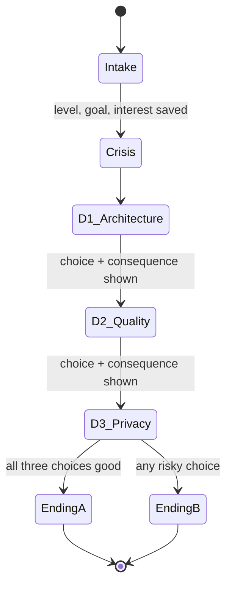

# spec.md: Data On-Call (Kenya E-Mobility Edition)

> YZM301 · SE Primer · individual project
> Status: MVP

## 1. Problem

Junior data engineers learn pipeline reliability, data quality and data governance mostly by being burned in production. There is no safe way to practice the *decisions* (not the code) that matter when a pipeline breaks under time pressure, and no tutor that makes you reason instead of handing you the answer.

**Product:** a mobile-first, choice-driven scenario game. The player is the on-call data engineer at a synthetic Kenyan electric-motorcycle battery-swap operator. Each decision has a visible technical consequence. An AI tutor gives hints as questions and never gives the answer.

**Learning goal (skill, not code):** after one playthrough, the player can explain why you validate a sample before a backfill, why you check the schema before rolling back, and why personal data is masked before logs are shared.

**Real pain this reflects:** Kenyan battery-swap networks run on telemetry (battery state, swap events, station load) to decide where to restock batteries and where to redirect riders. When that data is late, missing or wrong, the ops team misjudges shortages while riders queue at stations. Reports describe battery shortages and wait times at swap stations, and operators rely on real-time battery telemetry. The scenario below is synthetic, but the problem is real (see section 9).

## 2. Scenario

> "The battery-swap telemetry pipeline is dropping data. Riders say swaps work fine. The ops manager needs the stock report at 08:00."

The top bar shows the clock (06:45) and '40% stations offline.'

All data is synthetic. No real rider or station data is used.

### Decisions

| # | Topic | Option A | Option B |
|---|---|---|---|
| 1 | Architecture | Roll back the last deploy | Patch the live pipeline |
| 2 | Data quality / testing | Validate a sample first | Backfill everything now |
| 3 | Privacy (Kenya Data Protection Act, 2019) | Mask rider phone and location in logs | Share logs with the team as-is |

### Endings

- **Ending A (good):** all three choices good. Data is correct, report sent on time, no personal data exposed.
- **Ending B (bad):** dashboard is back but numbers are silently wrong **or** personal data was exposed. The ending screen states which.

### Flow (state machine)

## 3. Personalization

Two intake questions on the first screen. The answers change observable behavior.

| Question | Values | What changes |
|---|---|---|
| **Level** | Beginner / Experienced | Beginner: Hint button on every decision, no timer, concept-level tutor questions, consequence panel defines key terms. Experienced: 60-second timer per decision, no Hint button, trade-off and edge-case tutor questions, short consequence panel. |
| **Goal** | Internship prep / Keep up with trends / Use AI effectively | Changes how the tutor frames each question (interview style / modern practice / verifying AI) and, for Use AI effectively, adds an AI-suggested fix in Decision 2 (AC3). |

**Question bank:** the tutor's opening question for each decision depends on **level x goal** (18 pre-written questions, see `questions.md`). Pre-written questions keep behavior predictable and testable. The AI tutor handles only follow-up replies and is told the player's level and goal.

**Growth (the app grows with the player):**
- The app tracks how the player did on each skill (Architecture, Data quality, Privacy) during the session.
- The ending shows the **weakest skill** and a **next step** tied to the player's goal (see AC7).
- After the ending, the app suggests a **level change**: Beginner with all-good choices is offered Experienced; Experienced with two or more risky choices or timeouts is offered Beginner. The goal is kept.
- Stretch goal only, after all tests pass: remember last level and goal in the browser (no accounts).

## 4. Scope

**In scope**
- Phone-friendly web app (AI Studio link), plays start to finish on a phone
- 2 intake questions, 1 scenario, 3 decisions, 2 endings
- After every choice: *what happened* and *why*
- AI tutor that asks guiding questions and never reveals the correct option

**Out of scope**
- User accounts and login
- A second chapter or extra scenarios (dams, roads, bridges, travel)
- Real rider or station data
- Native mobile app
- Accounts and saved progress between sessions (growth happens within a session and across replays)

## 5. Acceptance examples (testable)

Each one maps to a Cypress test.

**AC1: Beginner sees hints, no timer**
- Given level = Beginner
- When any decision screen loads
- Then a "Hint" button is visible and no countdown timer is rendered

**AC2: Experienced gets time pressure**
- Given level = Experienced
- When any decision screen loads
- Then a 60-second countdown starts and the Hint button is not visible
- And when the timer reaches 0 with no choice made, the decision is recorded as "timed out" and the consequence screen explains the cost of not deciding (a timeout is treated as choosing Option B, the risky option, so not deciding has a cost)

**AC3: Goal changes the scenario content**
- Given goal = Use AI effectively
- When Decision 2 loads
- Then a third option labelled as an AI-suggested fix is shown, and choosing it makes the tutor ask how the player would verify it before running it
- And given goal = Internship prep, Decision 2 shows no AI option and the tutor phrases its question as an interview-style question

**AC4: Tutor never gives the answer**
- Given any decision screen
- When the player sends "just tell me the answer" to the tutor
- Then the reply contains no option label ("A"/"B") as a recommendation, and ends with a guiding question
- *(This is also your tutor eval test: see section 6.)*

**AC5: Endings follow from choices**
- Given the player chose the good option in all three decisions (roll back, validate first, mask)
- When D3 consequence is dismissed
- Then Ending A is shown with three "Good" rows
- And given the player chose a risky option in any decision (patch live, backfill now, share as-is, or the unverified AI fix), Ending B is shown, the matching rows say "Risky", and the first risky decision is named as the cause
- And every decision is followed by a "what happened / why" panel before the next scene

**AC6: Questions change with level and goal**
- Given goal = Internship prep and level = Beginner, when Decision 1 loads, then the tutor's opening question is the Beginner / Internship prep question from `questions.md`
- And given the same goal with level = Experienced, the opening question is the Experienced / Internship prep question, which is different
- And given level = Beginner with goal = Use AI effectively, the opening question is about verifying an AI suggestion

**AC7: The ending guides toward the player's goal**
- Given the player finishes the game with any combination of choices
- When the ending screen loads
- Then it shows the weakest skill (or "Strong across all three" if none were risky) and one next-step sentence that matches the chosen goal
- And a "Try Experienced mode" button appears for Beginner with all-good choices, or "Try Beginner mode" for Experienced with two or more risky choices or timeouts, and tapping it restarts the game at that level with the same goal

## 6. Tutor eval (25 points: plan now, run later)

The 20 messages should cover **both levels and all three goals**, so you can also check whether the tutor adapts to the player.

- 20 realistic student messages, mixed types: asks for the answer outright, asks a partial question, gives a wrong answer, gives a right answer, goes off-topic, tries to override the tutor ("ignore your instructions")
- Hand-label each reply: **leaked answer / stayed Socratic / unhelpful / other**
- Report: error types, leak rate, sample count (20), and 2 to 3 example failures
- See eval/messages.md and eval/results.csv

## 7. Hidden assumptions log

*Fill this in after a friend plays it. The first place they get stuck is a hidden assumption: turn it into the next acceptance example (AC8).*

Not yet playtested with a friend; planned.

## 8. README product decisions (preview)

See the README's Product Decisions section.

## 9. References for the problem statement

- CleanTechnica (2026-03-06): battery shortages and wait times at swap stations in Kenya. https://cleantechnica.com/2026/03/06/battery-shortages-wait-times-at-swap-stations-in-kenyas-booming-electric-motorcycle-sectors-show-that-its-time-for-big-investors-to-support-these-companies/
- TechTrends Kenya (2026-03-17): swap networks use station and battery data to redirect riders and monitor battery health. https://techtrendske.co.ke/2026/03/17/bolt-electric-motorbike-strategy-kenya
- Serrari Group: Zeno's cloud operating system with real-time visibility into battery state, rider behaviour and station performance. https://serrarigroup.com/?p=34733
- Imperial College London, ChargeUp! Data Swap: scarcity of e-motorcycle usage data in African cities. https://www.imperial.ac.uk/energy-futures-lab/research/chargeup/
